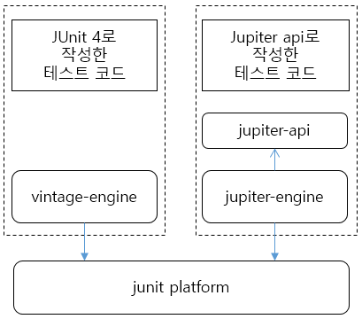

# JUnit
- Java에서 독립된 단위테스트를 지원해주는 프레임워크

## 단위 테스트(Unit Test)란?
- 특정 소스코드 모듈이 의도한 대로 잘 작동하는지 검증하는 테스트
- Spring에서 관리하는 Bean을 테스트
- 테스트의 단위가 엄격X
- 일반적으로 클래스 또는 메서드 수준으로 결정

### 장점
- 해당 부분만 독립적으로 테스트하기 때문에 문제 여부 파악 빠름

## JUnit이란?
- Java 개발자가 가장 많이 사용하는 테스팅 기반 프레임워크
- JUnit5는 3가지 모듈로 구성
- JUnit5 작성을 위한 API 모듈과 실행을 위한 API 존재
- assert 메서드로 테스트 케이스의 수행 결과를 판별
- 다양한 어노테이션 제공
- `@Test`를 사용 하면 메서드가 호출 할때마다 새로운 인스턴스를 생성해서 독립적인 테스트 실시

## JUnit 구조

JUnit5 = JUnit Platform + JUnit Jupiter + JUnit Vintage

- JUnit Platform: 테스트 실행을 위한 TestEngine 관리

- TestEngine: 테스트 실행 할때 정의되는 인터페이스

- JUnit Jupiter: 실제 테스트를 위한 구현체와 API
    - junit-jupiter-api: 라이브러리
    - junit-jupiter-engine: TestEngine 인터페이스를 구현하는 구현체

- JUnit Vintage Engine: 구버전 JUnit(3,4)를 JUnit5에서 실행 하기 위한 구현체

## 테스트의 Class, Method, 어노테이션
- Test도 자바 객체로 구성(Class + Method)

- Class: 최상위 클래스, static member class, @Nested class등 사용
    - absctract이면 안됨, 기본 생성자 꼭 포함

- Test Method: 
    - `@Test`: 테스트 메서드임
    - `@ParametherizedTest`:매개변수가 있는 테스트임
    - `@RepeatedTest`: 반복되는 테스트 메서드임

- LifeCycle Method(생명 주기): 
    - `@BeforeAll`: 테스트 메서드들이 실행되기 전 실행 테스트 시작 시점 한번 실행(static 메소드만 가능)
    - `@BeforeEach`: 각 테스트 메서드가 실행 되기 전 항상 실행(Mock 데이터 미리 세팅)
    - `@AfterAll`: 테스트 메서드들이 모두 실행된 후 딱 한번 실행(static 메소드만 가능)
    - `@AfterEach`: 각 테스트 메서드가 실행된 후 실행

## Assert
- `assertEquals(a, b)`: 두 값을 비교하여 일치 여부 판단
- `assertArrayEquals(a, b)`: 두 배열 일치 여부 판단 두 배열이 null이어도 동일한 것으로 판단
- `assertSame(a, b)`: 두 객체가 같은 객체인지 확인
- `assertTrue(a)`: a가 true인지 확인
- `assertNotNull(a)`: a가 null이 아님을 확인